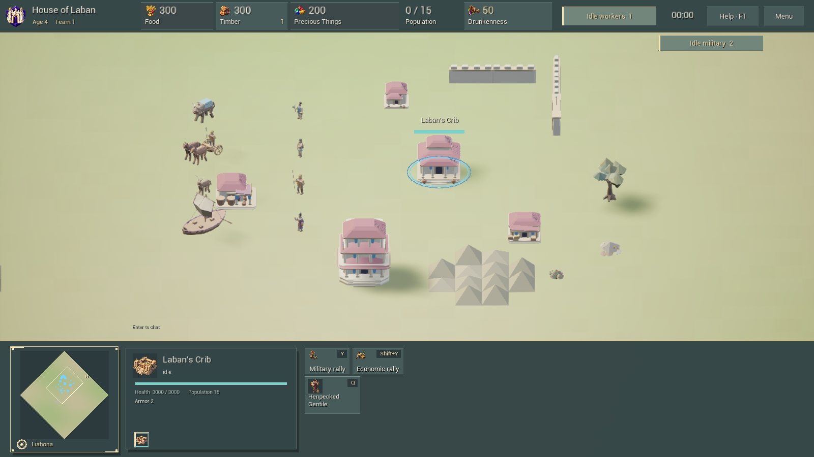

# Chronicles of the Promised Land

A Book of Mormon-inspired RTS built with Unreal Engine 5.3. **v0.9 development release** adds a low-poly 3D world, animated units, local bots, and 15 maps across six civilizations, with host-authoritative LAN multiplayer.



*Screenshot from an automated scene fixture.*

## Play

Download the **[v0.9 release](https://github.com/LeGrandMedia/chronicles-of-the-promised-land/releases/tag/v0.9.0)**:

- **Windows installer:** `Chronicles-Setup-v0.9.0-Windows-x64.exe`.
- **Windows portable:** extract `Chronicles-v0.9-Windows-Portable.zip`, then run `Chronicles-v0.9/Chronicles.exe`.
- **Android:** `Chronicles-v0.9-Android-arm64.apk` is an experimental sideload package. Its contents were verified, but it has not been launched on an Android device.

Unreal Editor is not required to play. Use the same build on every LAN computer. One player hosts; other players join the host's LAN IPv4 address. Local bots have three difficulty levels. See [player instructions](Revisions/v0.9/Docs/PlayerQuickStart-v0.9.md).

**No macOS or iPhone builds are available.** Windows multiplayer tests used separate processes on one computer; physical and cross-platform LAN remain unverified. The Windows installer has not completed clean-machine installation testing.

## Fork and develop

Fork this repository, clone your fork, and start with [AGENTS.md](AGENTS.md). Editable source, game assets, build tools, test evidence, and the canonical Obsidian design vault are included.

- Current implementation: [Revisions/v0.9](Revisions/v0.9).
- Design vault: [book of mormon RTS](book%20of%20mormon%20RTS), opened as a vault in Obsidian; begin at [Start Here](book%20of%20mormon%20RTS/00%20Navigation/Start%20Here.md).
- Verified handoff and remaining work: [Handoff-v0.9](Revisions/v0.9/Docs/Handoff-v0.9.md) and [Development-v0.9](Revisions/v0.9/Docs/Development-v0.9.md).
- Maps: [15-map catalog](Revisions/v0.9/Docs/Maps-v0.9.md).
- Game code: `Revisions/v0.9/Game/Source/Chronicles`.
- Editable names, gameplay data, icons, models and audio: `Revisions/v0.9/Game/Content/Data`.

The previous v0.8 project is retained for reference and reproducibility. Start new work in v0.9 or a clearly identified successor. The v0.9 source-and-vault ZIP uses the equivalent standalone folders `Chronicles-v0.9` and `Obsidian-Vault`. Raw engine/machine logs are omitted from this Git checkout; structured results and screenshots are retained.

## Build on Windows

Install Unreal Engine **5.3**, Visual Studio 2022 C++ Build Tools, and a Windows SDK. Target files pin MSVC **14.44.35207**. Review the [.NET SDK/toolchain instructions](Revisions/v0.9/Tools/ToolchainSetup.md) and script defaults for your installation paths. Engine/compiler installations and generated caches are excluded.

From the repository root:

```powershell
cd ".\Revisions\v0.9"
.\Tools\Package.ps1 -EngineRoot "C:\Program Files\Epic Games\UE_5.3"
.\Play.cmd
```

The first package must cook engine content; do not pass `-ReuseEngineCook` on a fresh checkout. `Build.ps1` alone does not update the packaged game. Python helpers require Python 3; handoff packaging requires Python 3.11 or newer. Android and Apple preparation scripts are documented separately; scripts are not proof of a working platform build.

## Validation and unfinished work

The delivered Windows build passed 4,234 map checks, 19 native reports, 46 gate cases, 57 bot assertions, and 17 entity-visibility checks. Scene and input suites passed at 1600x900 and 888x500, and a host/client/bot loopback match passed. See [the handoff](Revisions/v0.9/Docs/Handoff-v0.9.md) for exact executable identity, evidence and test limits.

Gadianton balance needs further work. Large units can visually clip the retained gate art; the unfinished replacement experiment is archived outside compiled source. Naval bot strategy, real-device performance/touch, clean Windows installation, physical LAN, Apple builds and external playtesting remain unfinished.

## Provenance

This is an independent game adaptation. The vault's [Source Ledger](book%20of%20mormon%20RTS/07%20Reference/Source%20Ledger.md) distinguishes fictional gameplay from textual inspiration. Asset provenance is retained with the project. No additional project license has been selected; Unreal Engine and third-party components retain their own terms. Engine source and installed development toolchains are not included.
