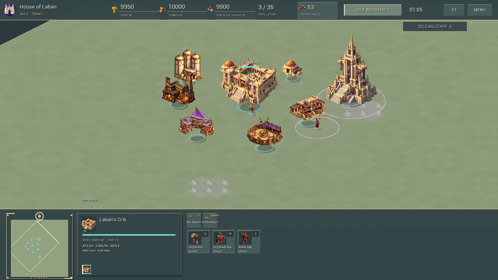

# Chronicles of the Promised Land

A Book of Mormon-inspired real-time strategy game for Windows, built with Unreal Engine 5.3. Current version: **v0.8**.

Six civilizations, resource gathering, base construction, armies, religious abilities, and direct LAN matches for up to four players. The game uses low-poly toon-inspired 2D artwork with animated sprite deformation and replaceable assets.



*Art showcase captured from an automated test fixture.*

## Play

Download **Chronicles-v0.8-Windows.zip** from [Releases](https://github.com/LeGrandMedia/chronicles-of-the-promised-land/releases/latest), extract the whole folder, and run **Chronicles.exe**. Unreal Editor is not required to play. The prerequisite installer is included under `Engine/Extras/Redist/en-us`.

Use the same version on every LAN computer. One player hosts; others join the host's LAN IPv4 address. The normal game port is UDP 7777. Solo Sandbox is also available.

## Fork and develop

Fork this repository with GitHub's **Fork** button, then clone your fork. The source, all game assets, build scripts, and the current Obsidian design vault are included. The **Chronicles-v0.8-Source-Game-Vault.zip** release download additionally includes the runnable Windows build in the same workspace layout.

- Current project: [Revisions/v0.8](Revisions/v0.8)
- Design vault: [book of mormon RTS](book%20of%20mormon%20RTS); open this folder as a vault in Obsidian.
- AI handoff: [AGENTS.md](AGENTS.md), then the vault's [Start Here](book%20of%20mormon%20RTS/00%20Navigation/Start%20Here.md).
- Gameplay changes and model labels: [task checklist](Revisions/v0.8/Docs/RevisionTasks-v0.8.md).
- Art and names: [replacement guide](Revisions/v0.8/Docs/ArtReplacement.md) and [naming guide](Revisions/v0.8/Docs/Naming.md).

Git history contains editable project files. Compiled builds and the larger handoff bundle are release assets, following [GitHub's binary-distribution guidance](https://docs.github.com/en/repositories/working-with-files/managing-large-files/about-large-files-on-github#distributing-large-binaries).

## Build on Windows

Install Unreal Engine **5.3**, Visual Studio 2022 C++ Build Tools, and a Windows SDK. Both target files pin MSVC **14.44.35207**; install that compiler or deliberately update both target files for your compatible installed toolchain. The .NET Framework SDK dependency is described in [ToolchainSetup](Revisions/v0.8/Tools/ToolchainSetup.md). Engine/compiler installations and rebuildable caches are not in this repository.

From the repository root:

```powershell
cd ".\Revisions\v0.8"
.\Tools\Package.ps1
.\Play.cmd
```

`Package.ps1` builds the game, cooks the engine Entry map, and stages the current code and data into `Builds/Windows`. Do not use `-ReuseEngineCook` before your first cook. `Build.ps1` alone does not update the packaged game preferred by `Play.cmd`.

Default installation paths are in the scripts. `Package.ps1` accepts `-EngineRoot`; `Build.ps1` accepts `-EngineRoot` and `-Toolchain`. If your Visual Studio location differs, adjust the Build.ps1 default or pass the setting through Package.ps1. Python helpers require Python 3; release packaging uses Python 3.11+.

## Test

From `Revisions/v0.8`, run these sequentially:

```powershell
.\Tools\Test-Revision-v08.ps1
.\Tools\Test-LAN-v08.ps1
```

The delivered game passed **693 counted native assertions**, **67 rendered-input checks at each of two resolutions**, and **four-process localhost multiplayer**. [Validation details](Revisions/v0.8/Docs/Validation-v0.8.md) include fixture limits. Native/input tests use the packaged executable; the multiplayer test runs one host and three clients on test port 17890.

Physical multi-computer LAN and human balance remain unverified. No host migration, reconnect, saved games, or Steam/public matchmaking. See [known limitations](Revisions/v0.8/Docs/KnownIssues.md).

## Project status and provenance

This is an independent game adaptation. [Source Ledger](book%20of%20mormon%20RTS/07%20Reference/Source%20Ledger.md) distinguishes fictional gameplay from textual inspiration. [Art provenance](Revisions/v0.8/Docs/ArtGeneration-v0.8.json) retains prompts and hashes; local machine paths are omitted. The robber voice is synthesized placeholder audio.

No additional project license has been selected. Unreal Engine and third-party components retain their own terms. No engine source or compiler installation is included. Historical v0.7 documents are references only; current work belongs in v0.8 or a clearly identified successor.
